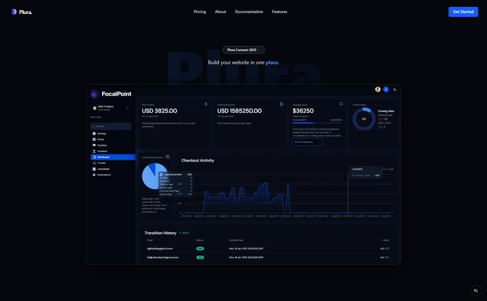

# Plura – Website Builder



Plura is a modern, fast, and intuitive website builder designed for creators, businesses, and developers who want to launch their ideas quickly.  
It features a clean UI, powerful customization options, and a responsive design out of the box.

## ✨ Features
- 🚀 **Fast** – Built with Next.js and optimized for performance.
- 🎨 **Customizable** – Flexible components and themes.
- 📱 **Responsive** – Works seamlessly on all devices.
- 🔐 **Secure** – Authentication and protected routes.

## 📦 Installation

```bash
# Clone the repository
git clone https://github.com/yourusername/plura.git

# Go to the project folder
cd plura

# Install dependencies
npm install

# Start development server
npm run dev

## Project links

[Source](https://github.com/Up-to-code/plura) · [Issues](https://github.com/Up-to-code/plura/issues) · [Public project directory](https://github.com/qentrah/.github/blob/main/profile/PROJECTS.md)
